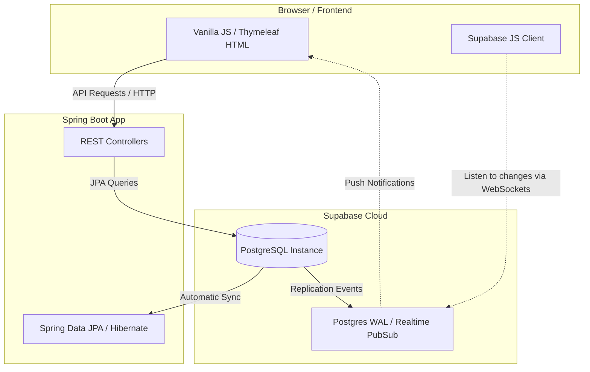
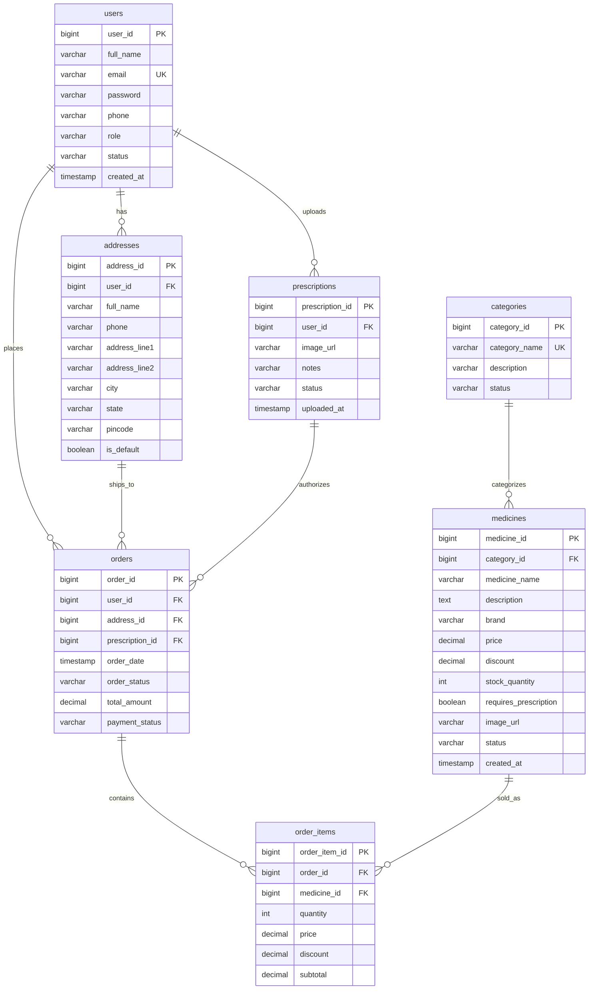

# 🩺 MediPulse - Online Pharmacy Platform

MediPulse is a premium, real-time web application for online pharmacy cataloging, prescription uploading, and order processing. The platform is built using a modern **Spring Boot** backend, **Thymeleaf & Vanilla JS** frontend, and **Supabase (PostgreSQL)** database with native **WebSocket-based Realtime subscriptions** to instantly sync inventory, order statuses, and prescription reviews.

---

## 🏗️ Architecture & Realtime Data Flow

The architecture diagram below illustrates how client sessions communicate with the Spring Boot server and establish direct real-time subscriptions to PostgreSQL tables using Supabase WebSockets.



---

## 📊 Entity Relationship Diagram (ERD)

The database schema is fully managed on Supabase PostgreSQL. Below is the Mermaid ER diagram representing the tables and relations:



---

## ✨ Features

- 🔐 **Premium Access Portal**: Standalone login/signup portal with custom CSS transitions. Includes easy-to-use "Quick Login" credentials for testing.
- ⚡ **Realtime Dynamic Updates**: Subscribes directly to Postgres events (inserts, updates, deletes) via Supabase client, auto-updating:
  - **Orders Queue**: Instant status updates (e.g. from PLACED to SHIPPED) across pharmacist/customer views.
  - **Inventory/Stock**: Auto-updates stock count when administrators modify products.
  - **Prescription Approvals**: Notifies customer when certified pharmacists approve or reject their Rx upload.
- 🩺 **Multi-Role Workspaces**:
  - **Customer**: Browse catalog, upload prescription documents, manage shopping cart, and track orders.
  - **Pharmacist**: Review uploaded prescriptions and manage dispatches.
  - **Admin**: Overall analytics KPI widgets and stock control dashboard.

---

## 🚀 Getting Started

### 1. Prerequisites
- **Java 21** (JDK 21 or later)
- **Maven** (or use the included wrapper `mvnw.cmd`)
- A **Supabase Account** with a PostgreSQL instance

### 2. Project Structure
The project is split into two separate directories:
- **`frontend/`**: Contains HTML views, CSS stylesheets, JavaScript files (including Supabase Realtime logic), and SVG media assets.
- **`backend/`**: Contains Spring Boot Java source code, REST controllers, JPA models/services, database scripts, and Maven configuration.

### 3. Configure Database & Keys
Open [backend/src/main/resources/application.properties](file:///c:/Users/sanja/OneDrive/Documents/online%20pharmacy/backend/src/main/resources/application.properties) and make sure your details are configured:

```properties
# Database Connection (Supabase PostgreSQL)
spring.datasource.url=jdbc:postgresql://db.<project-ref>.supabase.co:5432/postgres?sslmode=require
spring.datasource.username=postgres
spring.datasource.password=<your-supabase-db-password>

# API Keys (For Frontend Realtime WebSockets)
supabase.url=https://<project-ref>.supabase.co
supabase.anon-key=<your-anon-public-api-key>
```

### 4. Run Database Setup in Supabase
Run the SQL schema script (`backend/Database_schema.sql`) inside the **Supabase SQL Editor** to create the tables and enable realtime updates:

```sql
-- 1. Create tables
-- [Copy the contents of backend/Database_schema.sql]

-- 2. Enable Realtime Publications
ALTER PUBLICATION supabase_realtime ADD TABLE medicines;
ALTER PUBLICATION supabase_realtime ADD TABLE prescriptions;
ALTER PUBLICATION supabase_realtime ADD TABLE orders;
```

### 5. Start the Application
Navigate to the `backend/` directory and run the Maven wrapper to start the backend server:
```powershell
cd backend
.\mvnw.cmd spring-boot:run
```

Open **[http://localhost:8081](http://localhost:8081)** in your browser to explore!
